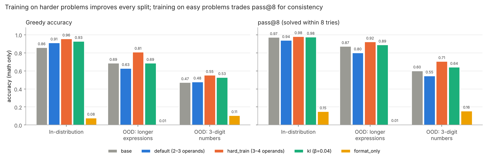
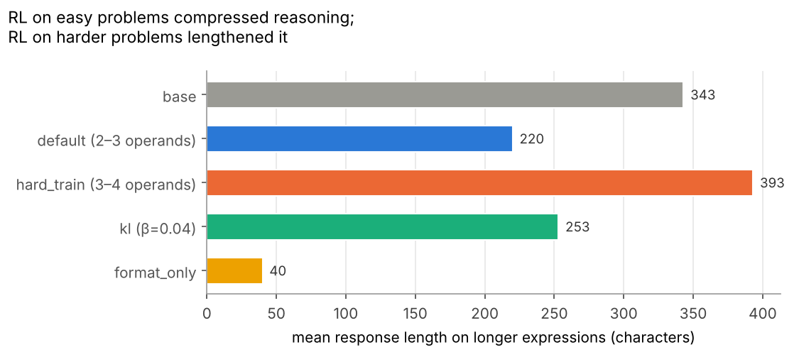
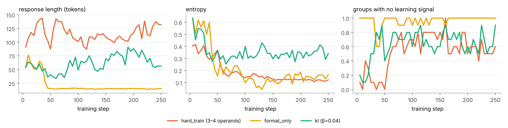

# When does RL teach a small LM new math? GRPO on Qwen2.5-0.5B

Reinforcement learning with verifiable rewards (GRPO) on a 0.5B-parameter language model, run entirely on a free T4 GPU. The question: **does RL teach the model to solve problems it couldn't solve before, or does it only make it more reliable at problems it could already sometimes solve?**



## Findings

All results are from a single training seed; multi-seed runs are in progress (see [Limitations](#limitations)).

1. **Training difficulty decides which one you get.** Trained on problems the base model already solved 86% of the time, GRPO *sharpened* the model: pass@1 rose 12–19 points, but pass@8 fell on every test set and accuracy on longer expressions dropped 6 points. Trained on harder problems with the same algorithm, reward and step count, GRPO improved greedy accuracy **and** pass@8 on every test set, including fully out-of-distribution ones (5-operand expressions: 0.65 → 0.75; 3-digit numbers: 0.47 → 0.55).
2. **The mechanism is reasoning length.** RL on easy problems shortened responses on long expressions by ~36% (343 → 220 characters), and the model started merging several operations into one line, which introduced errors. RL on harder problems lengthened them (→ 393).
3. **The correctness reward drives the gains; a format reward alone is exploited.** With only a format reward, the model learned to write an empty `<think></think>` and guess. Accuracy fell from 0.86 to 0.08.
4. **A KL penalty preserves diversity at the cost of smaller gains.** With β = 0.04, pass@8 stayed at or above the base model everywhere and the long-expression drop disappeared.
5. **Format-sensitive evaluation inflates RL gains enormously.** The base model writes correct reasoning but closes with `</thought>` instead of `</think><answer>`, so a strict tag-based metric scores it 0.003 while a math-only metric scores it 0.86. Measured strictly, RL would appear to add 60–90 points.

## Setup

| | |
|---|---|
| Model | `Qwen/Qwen2.5-0.5B-Instruct`, trained with LoRA (r = 16, all attention and MLP projections) |
| Algorithm | GRPO via TRL's `GRPOTrainer`: 8 samples per prompt, group-normalized advantages, no value network |
| Task | Synthetic integer arithmetic with `+ - *` (e.g. `36 - 8 * 7`), answers computed in Python |
| Rewards | Correctness 1.0 (final integer matches) + format 0.1 (`<think>…</think><answer>…</answer>`) |
| Training | 250 steps, lr 2e-5, 2 prompts × 8 generations per step, max 256 new tokens, temperature 1.0 |
| Compute | One T4 (free Kaggle / Colab tier). Baseline evaluation ~40 min, each experiment ~1 h |

**Data.** Every split is generated from a fixed seed, deduplicated, and checked so no test problem appears in training.

| Split | Problems | Purpose |
|---|---|---|
| `train` | 4,000 × (2–3 operands, 1–2 digits) | Default training data |
| `train_hard` | 4,000 × (3–4 operands, 1–2 digits) | `hard_train` experiment |
| `test_id` | 300, same distribution as `train` | In-distribution |
| `test_ood_length` | 300 × (4–5 operands) | Longer expressions. The 5-operand subset is unseen by every model. |
| `test_ood_digits` | 300 × (3-digit numbers) | Bigger numbers |

**Prompting.** Each response is pre-filled with `<think>\n`, so the model always starts inside the reasoning block. Without this, the base model alternated between Chinese tags, no tags and no reasoning at all (see [docs/EXPERIMENT_LOG.md](docs/EXPERIMENT_LOG.md)).

**Metrics.** Answers are parsed two ways. *Strict* requires the `<answer>` tag; *lenient* takes the tagged answer or, failing that, the last integer. All results below are lenient (math only), and format compliance is reported separately. pass@k uses the unbiased estimator from Chen et al. (2021) over 8 samples at temperature 0.8.

## Results

Lenient accuracy, 300 problems per split. "default" trains on 2–3 operand problems.

| Model | In-dist. greedy / pass@8 | Longer greedy / pass@8 | 3-digit greedy / pass@8 | 5-operand | Format |
|---|---|---|---|---|---|
| base | 0.860 / 0.973 | 0.687 / 0.873 | 0.473 / 0.603 | 0.654 | 0.00 |
| default | 0.913 / 0.940 | 0.630 / 0.803 | 0.480 / 0.547 | 0.590 | 1.00 |
| **hard_train** | **0.957 / 0.983** | **0.810 / 0.923** | **0.553 / 0.707** | **0.750** | 0.98 |
| kl (β = 0.04) | 0.930 / 0.977 | 0.687 / 0.890 | 0.530 / 0.643 | 0.654 | 0.00 |
| format_only | 0.080 / 0.150 | 0.007 / 0.010 | 0.107 / 0.157 | 0.000 | 1.00 |

**Paired tests against the base model** (same problems; exact McNemar test). *Fixed / broken* counts problems whose greedy answer changed from wrong to right or right to wrong. *Gained / lost* counts problems solved at least once within 8 samples by only one of the two models.

| Model | Split | Fixed / broken (p) | Gained / lost within 8 samples (p) |
|---|---|---|---|
| default | In-dist. | 25 / 9 (0.009) | 1 / 11 (0.006) |
| default | Longer | 31 / 48 (0.07) | 9 / 30 (0.001) |
| default | 3-digit | 20 / 18 (0.87) | 3 / 20 (<0.001) |
| hard_train | In-dist. | 34 / 5 (<0.001) | 5 / 2 (0.45) |
| hard_train | Longer | 54 / 17 (<0.001) | 21 / 6 (0.006) |
| hard_train | 3-digit | 39 / 15 (0.002) | 38 / 7 (<0.001) |

For the default run, 95% paired-bootstrap confidence intervals on the pass@8 change exclude zero on all three splits (In-dist. −0.033 [−0.057, −0.013]; Longer −0.070 [−0.110, −0.030]; 3-digit −0.057 [−0.087, −0.027]).



**Sharpening in the default run.** The share of in-distribution problems on which the 8 samples disagree fell from 79% to 10%: the model became close to deterministic. That explains why pass@1 rose sharply while greedy accuracy barely moved and pass@8 fell.


**Reasoning compression.** On the 48 long expressions the default run newly got wrong, its responses averaged 203 characters against the base model's 431. A typical failure merges steps: `6 − 26 + 62 = −18 + 62 = 44` (correct: 42).

**Training dynamics.** With only the format reward, responses collapse to ~15 tokens within 50 steps. Under the KL penalty, entropy stays 2–3× higher than in the other runs. Logs for the default run were not saved, so it is absent from this plot.



## Limitations

- **Single seed.** Every number comes from one training run. A notebook that adds two more seeds each for `default` and `hard_train` is included (`RUN_LIST` in the experiments cell).
- **pass@8 is not pass@∞.** "Gained within 8 samples" may partly reflect problems the base model would solve with more attempts. The same notebook evaluates pass@64 to test this.
- **The KL comparison is confounded.** The KL model never learned the format (format rate 0.00), so it differs from the default run in two ways at once.
- **Scale and task.** One small model and synthetic arithmetic. The effects may differ for larger models or natural-language math.

## Reproduce

1. Open `notebooks/grpo_arithmetic.ipynb` on Kaggle or Colab with a **T4 GPU** (Kaggle: Settings → Accelerator → GPU T4; turn Internet on).
2. In the experiments cell, set `RUN_LIST` to the experiments you want: `default`, `hard_train`, `format_only`, `kl`, or the seed variants `hard_train_s1`, `default_s2`, etc.
3. Run all cells. On Kaggle, use *Save Version → Save & Run All* so it runs in the background. Results are written to `runs/grpo_arith_experiments/<experiment>/`.
4. Paired analysis of any trained model against the base model (try it on the included files: `--base results/raw/base_eval.json --model results/raw/default_eval.json`):
   ```bash
   python analysis/analyze.py --base runs/.../base_eval.json --model runs/.../hard_train/grpo_eval.json \
       --label hard_train --plot pass_at_k.png
   ```

The notebook writes `rlmath.py` itself (first cells), so it runs standalone. A tiny-model CPU smoke test is available with `SMOKE=1`.

## Repository layout

```
rlmath.py                    data generation, prompts, parsing, rewards, evaluation (pass@k)
notebooks/grpo_arithmetic.ipynb   end-to-end: baseline, experiments, analysis
analysis/analyze.py          paired statistics vs. base (McNemar, bootstrap CIs, coverage)
analysis/make_figures.py     regenerates the figures from results/
results/summary.json         all headline numbers and paired tests
results/train_logs_experiments.json   training logs for hard_train, kl, format_only
results/raw/                 per-problem evaluations (base, default) used for the paired statistics
docs/CODE_WALKTHROUGH.md     how the code works, section by section
docs/EXPERIMENT_LOG.md       every run, what went wrong, and what it taught
```

## References

- Shao et al., 2024. *DeepSeekMath: Pushing the Limits of Mathematical Reasoning in Open Language Models* (introduces GRPO).
- Yue et al., 2025. *Does Reinforcement Learning Really Incentivize Reasoning Capacity in LLMs Beyond the Base Model?* (pass@k analysis of RL sharpening).
- Shao et al., 2025. *Spurious Rewards: Rethinking Training Signals in RLVR.*
- Chu et al., 2025. *SFT Memorizes, RL Generalizes.*
- Chen et al., 2021. *Evaluating Large Language Models Trained on Code* (unbiased pass@k estimator).
- Hugging Face TRL: `GRPOTrainer`.
