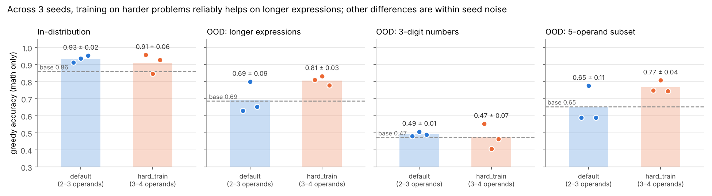
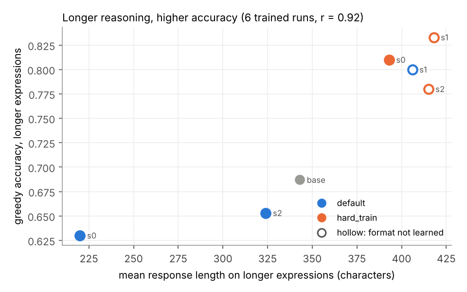
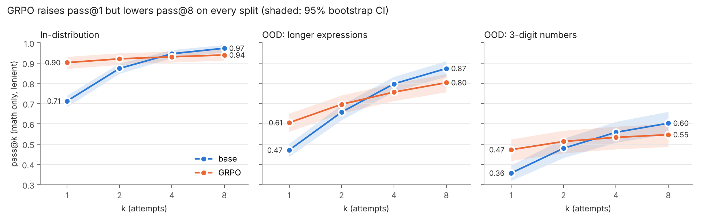

# When does RL teach a small LM new math? GRPO on Qwen2.5-0.5B

Reinforcement learning with verifiable rewards (GRPO) on a 0.5B-parameter language model, run entirely on a free T4 GPU. The question: **does RL teach the model to solve problems it couldn't solve before, or does it only make it more reliable at problems it could already sometimes solve?**



## Findings

1. **Training on harder problems reliably improves generalization to longer problems.** Across 3 training seeds, GRPO on 3–4 operand problems raised greedy accuracy on longer (4–5 operand) expressions from 0.69 to **0.81 ± 0.03**, and on the fully unseen 5-operand subset from 0.65 to **0.77 ± 0.04**. Every seed beat the base model on both (on longer expressions, paired McNemar p < 0.001 for each seed). Training on 2–3 operand problems gave **0.69 ± 0.09**: one seed improved, two did not.
2. **Reasoning length tracks that accuracy.** Across the 6 trained runs, mean response length on longer expressions correlates with accuracy there at r = 0.92. The runs that got worse wrote shorter reasoning and merged several operations into one line, e.g. `6 − 26 + 62 = −18 + 62 = 44` (correct: 42).
3. **The gain is mostly reliability, not new capability, on longer expressions.** At 64 samples per problem, the base model and the hard-trained model solve almost the same set (0.96 vs 0.98; 4 vs 2 problems solved by only one, p = 0.69), while pass@1 rises from 0.46 to 0.82. On 3-digit numbers there is some evidence of expanded coverage (0.71 → 0.82 at k = 64; 16 vs 5 problems, p = 0.03; one seed, 100 problems).
4. **The correctness reward drives the gains; a format reward alone is exploited.** With only a format reward, the model learned to write an empty `<think></think>` and guess. Accuracy fell from 0.86 to 0.08.
5. **Single-seed results can mislead.** The first run showed classic RL "sharpening", with pass@8 falling on every test set. That pattern did not replicate in the other two seeds. Whether the model even learned the output format varied by seed (3 of 6 runs).
6. **Format-sensitive evaluation inflates RL gains enormously.** The base model writes correct reasoning but closes with `</thought>` instead of `</think><answer>`, so a strict tag-based metric scores it 0.003 while a math-only metric scores it 0.86.

## Setup

| | |
|---|---|
| Model | `Qwen/Qwen2.5-0.5B-Instruct`, trained with LoRA (r = 16, all attention and MLP projections) |
| Algorithm | GRPO via TRL's `GRPOTrainer`: 8 samples per prompt, group-normalized advantages, no value network |
| Task | Synthetic integer arithmetic with `+ - *` (e.g. `36 - 8 * 7`), answers computed in Python |
| Rewards | Correctness 1.0 (final integer matches) + format 0.1 (`<think>…</think><answer>…</answer>`) |
| Training | 250 steps, lr 2e-5, 2 prompts × 8 generations per step, max 256 new tokens, temperature 1.0 |
| Compute | One T4 (free Kaggle / Colab tier). Baseline evaluation ~40 min, each training run 60–90 min including evaluation |

**Data.** Every split is generated from a fixed seed, deduplicated, and checked so no test problem appears in training. Training seeds change only the training randomness (LoRA initialization, sampling during RL, batch order); data and test sets are identical across all runs.

| Split | Problems | Purpose |
|---|---|---|
| `train` | 4,000 × (2–3 operands, 1–2 digits) | `default` training data |
| `train_hard` | 4,000 × (3–4 operands, 1–2 digits) | `hard_train` training data |
| `test_id` | 300, same distribution as `train` | In-distribution |
| `test_ood_length` | 300 × (4–5 operands) | Longer expressions. The 5-operand subset is unseen by every model. |
| `test_ood_digits` | 300 × (3-digit numbers) | Bigger numbers |

**Prompting.** Each response is pre-filled with `<think>\n`, so the model always starts inside the reasoning block. Without this, the base model alternated between Chinese tags, no tags and no reasoning at all (see [docs/EXPERIMENT_LOG.md](docs/EXPERIMENT_LOG.md)).

**Metrics.** Answers are parsed two ways. *Strict* requires the `<answer>` tag; *lenient* takes the tagged answer or, failing that, the last integer. All results below are lenient (math only), and format compliance is reported separately. pass@k uses the unbiased estimator from Chen et al. (2021) over 8 samples at temperature 0.8.

## Results

### Across seeds

Greedy accuracy, lenient, mean ± std over 3 training seeds (300 problems per split).

| | In-dist. | Longer | 3-digit | 5-operand |
|---|---|---|---|---|
| base | 0.860 | 0.687 | 0.473 | 0.654 |
| default (2–3 operands) | 0.934 ± 0.020 | 0.694 ± 0.092 | 0.492 ± 0.013 | 0.652 ± 0.107 |
| **hard_train** (3–4 operands) | 0.910 ± 0.057 | **0.808 ± 0.027** | 0.474 ± 0.074 | **0.767 ± 0.035** |

pass@8, same runs:

| | In-dist. | Longer | 3-digit |
|---|---|---|---|
| base | 0.973 | 0.873 | 0.603 |
| default | 0.972 ± 0.028 | 0.870 ± 0.064 | 0.649 ± 0.089 |
| hard_train | 0.973 ± 0.009 | 0.909 ± 0.034 | 0.682 ± 0.051 |

Per-seed values and paired tests are in `results/summary.json`. On longer expressions, all three `hard_train` seeds improve significantly over the base model (fixed/broken: 54/17, 56/12, 41/13). For `default`, only one of three does (51/17; the others 31/48 and 39/49).

On in-distribution and 3-digit problems, the two training distributions are within seed noise of each other. One `hard_train` seed was below the base model on 3-digit numbers (0.41 vs 0.47, p = 0.07).



### pass@64: reliability or new capability?

100 problems per OOD split, 64 samples each, base vs `hard_train` seed 1.

| | Longer pass@1 | Longer pass@64 | 3-digit pass@1 | 3-digit pass@64 |
|---|---|---|---|---|
| base | 0.464 | 0.960 | 0.334 | 0.710 |
| hard_train | 0.818 | 0.980 | 0.350 | 0.820 |

On longer expressions, almost everything the trained model solves, the base model also solves given 64 tries: RL made the model far more reliable, not more capable. On 3-digit numbers the trained model solves 16 problems the base never does in 64 tries, versus 5 the other way (p = 0.03). That is modest evidence of expanded coverage, from one seed.

### Controls (seed 0)

| Model | In-dist. greedy / pass@8 | Longer greedy / pass@8 | 3-digit greedy / pass@8 | Format |
|---|---|---|---|---|
| base | 0.860 / 0.973 | 0.687 / 0.873 | 0.473 / 0.603 | 0.00 |
| kl (β = 0.04, 2–3 operands) | 0.930 / 0.977 | 0.687 / 0.890 | 0.530 / 0.643 | 0.00 |
| format_only (no correctness reward) | 0.080 / 0.150 | 0.007 / 0.010 | 0.107 / 0.157 | 1.00 |


With only the format reward, responses collapse to ~15 tokens within 50 steps. Under the KL penalty, entropy stays 2–3× higher than in the other runs.

### The first run, in detail

The first `default` run (seed 0) is analyzed in depth in [docs/EXPERIMENT_LOG.md](docs/EXPERIMENT_LOG.md). It showed sharpening: samples that disagreed on in-distribution problems fell from 79% to 10%, and pass@8 dropped on all three splits (95% paired-bootstrap CIs excluding zero). Its reasoning on longer expressions shrank by 36%. The other two seeds did not show the pass@8 drop. The link between shorter reasoning and lower accuracy on long problems did hold across all six runs.



## Limitations

- **Three seeds** per configuration, and one seed for the controls and pass@64. Seed variance is large for `default` (± 0.09 on longer expressions), so smaller differences here should not be read as effects.
- **Format learning varies by seed** (3 of 6 runs) and correlates with shorter reasoning in the `default` runs. With this few runs, its effect can't be separated from the training distribution.
- **The KL comparison is confounded.** The KL model never learned the format, so it differs from the default run in two ways at once.
- **Scale and task.** One small model and synthetic arithmetic. The effects may differ for larger models or natural-language math.

## Reproduce

1. Open `notebooks/grpo_arithmetic.ipynb` on Kaggle or Colab with a **T4 GPU** (Kaggle: Settings → Accelerator → GPU T4; turn Internet on).
2. In the experiments cell, set `RUN_LIST` to the experiments you want: `default`, `hard_train`, `format_only`, `kl`, or the seed variants `default_s1`, `hard_train_s2`, etc.
3. Run all cells. On Kaggle, use *Save Version → Save & Run All* so it runs in the background. Results are written to `runs/grpo_arith_experiments/<experiment>/`.
4. Paired analysis of any trained model against the base model (try it on the included files: `--base results/raw/base_eval.json --model results/raw/default_eval.json`):
   ```bash
   python analysis/analyze.py --base runs/.../base_eval.json --model runs/.../hard_train/grpo_eval.json \
       --label hard_train --plot pass_at_k.png
   ```

The notebook writes `rlmath.py` itself (first cells), so it runs standalone. A tiny-model CPU smoke test is available with `SMOKE=1`.

## Repository layout

```
rlmath.py                    data generation, prompts, parsing, rewards, evaluation (pass@k)
notebooks/grpo_arithmetic.ipynb   end-to-end: baseline, experiments, seeds, pass@64, analysis
analysis/analyze.py          paired statistics vs. base (McNemar, bootstrap CIs, coverage)
analysis/make_figures.py     regenerates the figures from results/
results/summary.json         all headline numbers, per-seed results, paired tests, pass@64
results/train_logs_experiments.json   training logs for hard_train, kl, format_only (seed 0)
results/raw/                 per-problem evaluations (base, default seed 0) used for the paired statistics
docs/CODE_WALKTHROUGH.md     how the code works, section by section
docs/EXPERIMENT_LOG.md       every run, what went wrong, and what it taught
```

## References

- Shao et al., 2024. *DeepSeekMath: Pushing the Limits of Mathematical Reasoning in Open Language Models* (introduces GRPO).
- Yue et al., 2025. *Does Reinforcement Learning Really Incentivize Reasoning Capacity in LLMs Beyond the Base Model?* (pass@k analysis of RL sharpening).
- Shao et al., 2025. *Spurious Rewards: Rethinking Training Signals in RLVR.*
- Chu et al., 2025. *SFT Memorizes, RL Generalizes.*
- Chen et al., 2021. *Evaluating Large Language Models Trained on Code* (unbiased pass@k estimator).
- Hugging Face TRL: `GRPOTrainer`.
